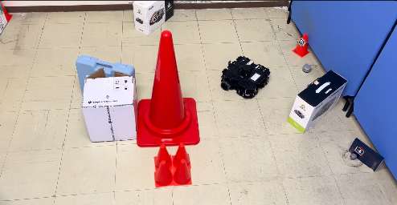

From March to May 2026 I worked in the Uchiyama Laboratory at Toyohashi University of Technology (豊橋技術科学大学) through the Short-Term Visiting International Students program. The task: make a TurtleBot3 move around a cluttered lab on its own, find marked stations, and park precisely in front of each one. The code is open source at [theonegareth/turtlebot-toyohashi](https://github.com/theonegareth/turtlebot-toyohashi).

The goal was a robot that makes round trips between set points on its own, avoiding obstacles with its LiDAR and camera. The AprilTag stations are the precise end points of those trips; in the hub-and-spoke version the hub could be a parking spot or a charging point.

## The problem: odometry drifts, and the nav stack stops short

A TurtleBot estimates where it is by counting wheel turns. Every small slip adds up, so after a few laps of the room the robot's idea of its position is wrong by tens of centimetres. The standard ROS navigation stack (`move_base`) handles the long journey well enough, but it is built to get *near* a goal, not to line up with one. For the final approach I needed something that looks at the target itself.

On one waypoint run with odometry alone, the robot's position estimate drifted by about 0.09 m in x and 0.78 m in y; on another, by about 0.38 m and 0.45 m.

## The setup

- **Robot:** TurtleBot3 Burger running ROS Noetic, with its LiDAR for walls and obstacles.
- **Camera:** a Raspberry Pi Camera V2 through `raspicam_node`, using the 1280×960 profile. Brevan and I re-ran the intrinsic calibration (focal lengths, optical centre, lens distortion) and committed the new values on 4 May 2026; the AprilTag distance estimates depend on them.
- **Markers:** AprilTags from the `tag36h11` family printed at 2.5 cm (the committed `tags.yaml` still lists 38.5 mm for IDs 0–19; the 2.5 m × 3.2 m test area used six of them: 7, 18, 10, 0, 4 and 2), detected with `apriltag_ros`, which publishes each tag's position relative to the camera.

## Step 1: turning tags into waypoints

Before the robot can drive to a station it has to know where the stations are. A mapping node watches the transform from the map to each visible tag and writes the tag's position and heading to `lab_waypoints.json`.

The first version saved a tag the moment it saw one. That produced ghost tags: peeling paint and reflections occasionally looked like a marker for a frame. The fix (16 April) was to require **five detections** of the same tag before saving it. Later versions explore on their own: the robot follows the right-hand wall, and whenever it sees a tag it has not visited within 1 m, it breaks off, docks to it, records the pose and carries on.

## Step 2: getting close, airport style

I borrowed airport vocabulary for the approach, and it stuck in the code (the log messages are prefixed `[ATC]`):

1. **Taxiway:** drive on odometry to a point 0.50 m out from the target tag.
2. **Staging:** move to 0.35 m, roughly square to the tag.
3. **Handover:** the moment the camera sees the target tag, anywhere on the way, odometry stops being trusted and the visual controller takes over. If the robot reaches the staging point without a sighting, it spins slowly (0.25 rad/s) until it finds the tag. (The two `move_base` variants hand over once the tag is within 0.9 m or 1.0 m.)
4. **Pushback:** after docking, reverse about 0.67 m (0.15 m/s for 4.5 s) before heading to the next gate.

A fixed "hub" point in the room acts as a safe junction between gates, so the robot never cuts across posts on the way from one station to the next.

## Step 3: the final approach, visual servoing

The docking controller is deliberately small. In the main navigator, from each detection it takes two numbers: the tag's sideways offset `x` and its distance `z` from the camera.

- **Heading error** is the angle to the tag, `atan2(x, z)`. Turning speed is `-1.0 × heading error`.
- **Distance error** is `z` minus the target stand-off. Forward speed is `0.5 × distance error`.
- If the heading error is above 0.15 rad (about 9°), forward speed drops to the 0.08 m/s minimum while the robot turns toward the tag, so it fixes its heading before it closes the distance.
- Forward speed never drops below **0.08 m/s**, because below that the wheels stalled on the lab floor and the robot stopped short of the tag.
- It counts as docked when the distance error is under **3 cm** and the heading error under **0.05 rad** (about 3°).
- If the tag drops out of view, the last detection is kept for two more detection messages, so a single missed frame does not end the approach. If the tag is still missing after that, the robot stops, abandons that dock and backs out.

The stand-off distance differs by script (20 cm in the tag-only navigator, 25 cm in the main one, 30 cm while exploring, where the gains are a little higher at 1.2 and 0.6). Proportional control like this is the simplest thing that could work, and on a slow robot with a good camera calibration it was enough.

## Results

After calibration we checked the camera's distance estimate against a measured distance: a tag at 15.00 cm read as 15.04 cm (0.4 mm, 0.26%), and at 30.0 cm as 30.43 cm (about 4 mm). That is the accuracy of the distance the controller steers on, not of where the robot stops; the controller itself stops within 3 cm and 0.05 rad of its target.

## What went wrong along the way

- **Ghost tags** from peeling paint and reflections, fixed by the five-detection rule.
- **Wheels stalling** at low speed on the lab floor, fixed by the 0.08 m/s floor on forward speed (an early version also set 0.15 rad/s on turning).
- **A late clean-up (June 2026)** after the lab work: a mismatch between coordinate frames, a callback that blocked the control loop, crashes on missing data, decisions made on stale detections, and a loop that kept rewriting the waypoint file to disk.

## What I would do next

The improvement list in our final deck still stands. Between tags the robot trusts its wheels, so the first step is to fuse the IMU, the wheel encoders and every AprilTag fix into one position estimate instead of switching from odometry to vision. The second is to use every visible tag at once and triangulate from them, rather than one target at a time. The third is a logarithmic glideslope: slow down exponentially over the last stretch to the 30 cm mark instead of the plain proportional approach.

## Team

This was a team project with Brevan Anthony: the two of us made up the camera and AprilTag group of a five-person Toyohashi team, alongside Joel Matthew Setiyanto, Raymond Rijadi and Bryan Wilberd Lo, who worked on LiDAR obstacle avoidance. Uchiyama Naoki and Muhammad Nurul Puji supervised, together with Matthew Kunaifi, Fadli Due R. and Diaz Wigunar Coco.

## Code

Everything is in [theonegareth/turtlebot-toyohashi](https://github.com/theonegareth/turtlebot-toyohashi) (MIT licence): the mappers, the navigators (odometry, two `move_base` hand-over variants, and tag-only), the AprilTag configuration and the calibrated camera files. The project summary is on the [TurtleBot Autonomous Navigation](/projects/turtlebot-autonomous-navigation/) page.
